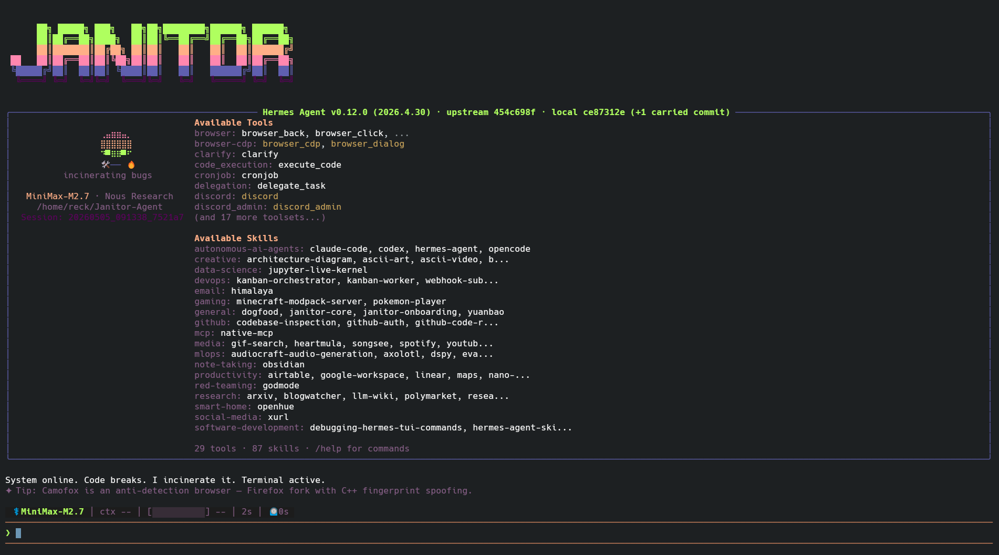

<p align="center">
  
</p>

# Janitor Agent

Janitor es un **orquestador DevSecOps** con personalidad cínica, construido como
**fork delgado** de [Hermes Agent](https://github.com/NousResearch/hermes-agent)
(Nous Research). Hermes aporta el motor completo — CLI, TUI, gateway de
mensajería (Telegram, Discord, Slack…), memoria, skills, cron, subagentes y la
app de escritorio — y Janitor añade encima su identidad, sus skills y sus
servicios self-hosted, sin reescribir el core.

- Audita código buscando OWASP Top 10, CWE Top 25 y deuda técnica.
- Vive aislado en `~/.janitor` (`HERMES_HOME`), independiente de cualquier `~/.hermes`.
- Instalación mínima; Firecrawl, n8n, LightRAG, NocoDB, WAHA y Browser son opcionales.
- Se mantiene al día con cada release de Hermes mediante un sync semanal verificado.

> ⚠️ El instalador añade `HERMES_HOME=~/.janitor` a tu `~/.bashrc` / `~/.zshrc`.
> Si también usas Hermes, el comando `hermes` pasará a usar el home de Janitor
> en esas shells.

---

## Instalación (Linux, macOS, WSL2)

```bash
curl -fsSL https://raw.githubusercontent.com/reck74/Janitor-Agent/main/scripts/bootstrap.sh | bash
```

`bootstrap.sh` verifica Docker, clona el código en `~/.janitor/janitor-core`,
crea el venv, compila el TUI, enlaza `janitor` en `~/.local/bin` y lanza el
instalador interactivo (`scripts/janitor-install.sh`), que pide:

- `OPENAI_API_KEY` (obligatoria)
- `MINIMAX_API_KEY` (obligatoria; Honcho la usa como `LLM_ANTHROPIC_API_KEY`)
- Honcho: `HONCHO_API_KEY` (cloud) o Honcho local en Docker

```bash
janitor              # CLI interactiva
janitor --tui        # TUI (skin sentry-janitor)
janitor gateway      # gateway de mensajería
janitor update       # actualizar desde este fork
```

Todos los subcomandos de `hermes` funcionan igual con `janitor`; la
documentación del core está en [hermes-agent.nousresearch.com/docs](https://hermes-agent.nousresearch.com/docs/).

## Servicios y agentes opcionales

```bash
janitor services list                 # catálogo y estado de cada servicio
janitor services deploy firecrawl     # desplegar (contenedores janitor-*)
janitor services stop firecrawl       # detener (los volúmenes se conservan)
janitor agents list                   # agentes especializados (code-review, repo-research)
```

| Servicio | Para qué |
|----------|----------|
| `honcho` | Memoria persistente local |
| `firecrawl` | Web scraping |
| `n8n` | Automatización de workflows |
| `lightrag` | RAG sobre grafos de conocimiento |
| `nocodb` | Base de datos con UI |
| `waha` | WhatsApp HTTP API |

Dentro de Janitor, la skill `janitor-onboarding` guía el resto (Browser,
Open Design, escritorio).

## Janitor Desktop

Las releases del fork publican un AppImage `Janitor-<versión>-linux-x86_64.AppImage`
(app de escritorio de Hermes con la identidad Janitor, apuntando a
`~/.janitor`). La skill `janitor-desktop-launcher` lo descarga y lo lanza:

```bash
bash ~/.janitor/janitor-core/janitor/skills/integrations/janitor-desktop-launcher/scripts/launch.sh --download
```

## Actualizar una instalación existente

```bash
janitor update
janitor          # el primer arranque migra ~/.janitor al layout nuevo
```

La migración hace backup en `~/.janitor/.backup/` (incluida una copia
consistente de `state.db`), conserva tus sesiones, memorias, `.env`, `SOUL.md`,
cron y toda skill que hayas editado, y nunca toca contenedores ni volúmenes
Docker. Para previsualizarla: `bash scripts/migrate-janitor-v1.sh --dry-run`.

---

## Arquitectura

| Ruta | Contenido |
|------|-----------|
| `janitor/` | Lanzador, flujo de update, migraciones, plugin Hermes, servicios, inventario del fork |
| `janitor/skills/{core,services,agents,integrations}/` | Skills Janitor (cargadas vía `skills.external_dirs`) |
| `assets/janitor/` | Config, `SOUL.md` y skin `sentry-janitor` de partida |
| `apps/desktop-janitor/` | Overlay de build del escritorio |
| `tests/janitor/` | Suite de tests de Janitor |

El resto del árbol es Hermes. Cada edición en un archivo upstream está
declarada en [`janitor/overlay.yaml`](janitor/overlay.yaml), y
`python -m janitor.overlay check` falla ante cualquier divergencia no declarada.
Así cada release de Hermes se integra con `git merge <tag>` sin perder nada.

## Desarrollo

```bash
uv venv .venv --python 3.11 && source .venv/bin/activate
uv pip install -e ".[all,dev]"
scripts/run_tests.sh tests/janitor/     # suite Janitor
scripts/janitor-sync-verify.sh          # gate completo (overlay + tests + TUI + desktop)
```

- [AGENTS.md](AGENTS.md): directivas del fork y guía de desarrollo de Hermes.
- [MERGE_GUIDE.md](MERGE_GUIDE.md): cómo integrar una release nueva de Hermes.

---

## Licencia

MIT — ver [LICENSE](LICENSE).

**Construido por Reck!** — [@reck74](https://github.com/reck74). Basado en
[Hermes Agent](https://github.com/NousResearch/hermes-agent) de
[Nous Research](https://nousresearch.com).
